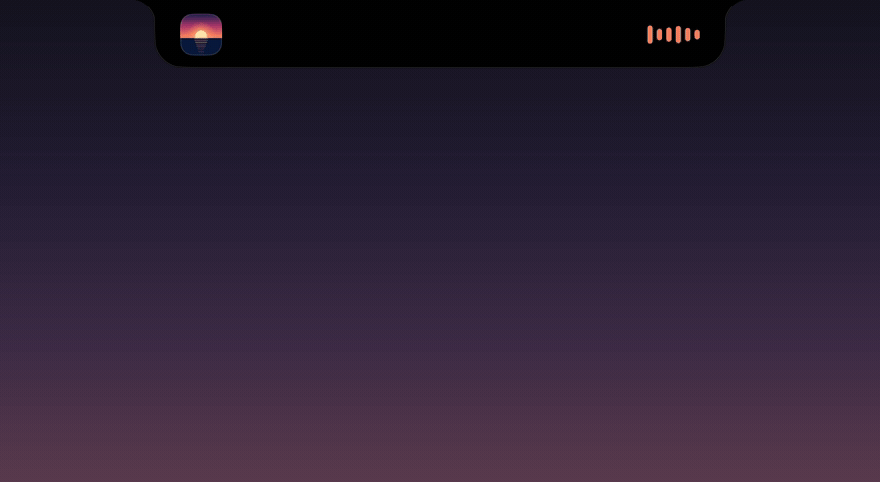
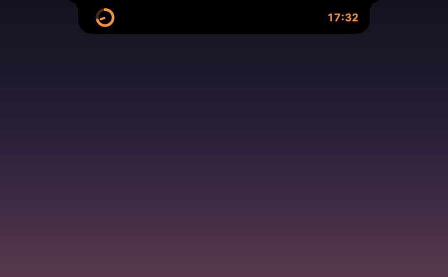
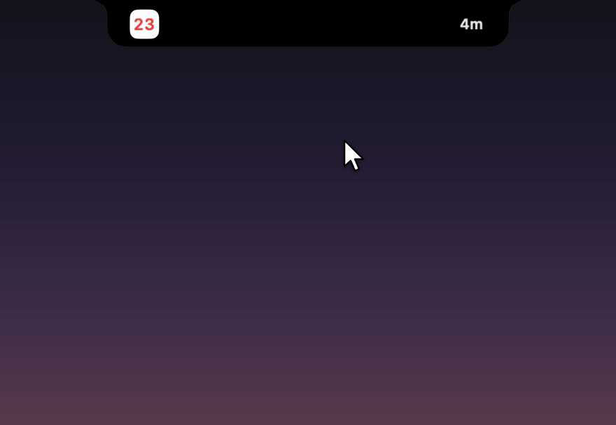
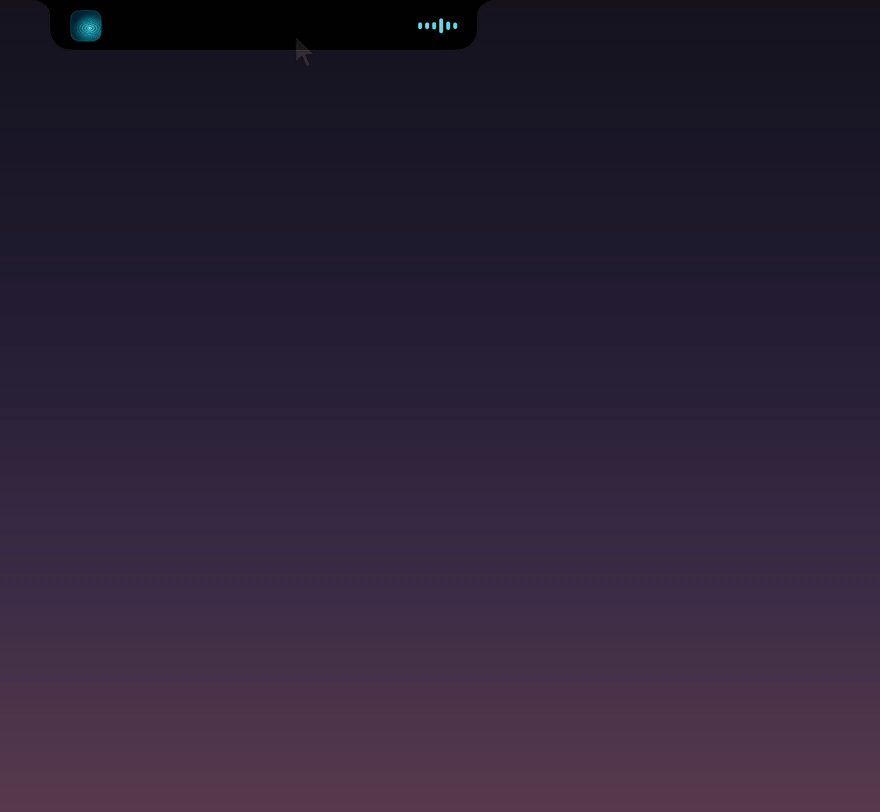
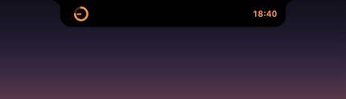
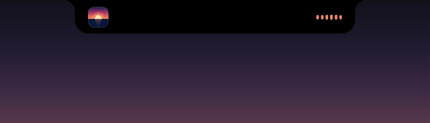

<div align="center">

# Ledge

**Your MacBook's notch, put to work.**

You already look up there. Ledge puts what you're checking anyway — the song,
the timer, the next meeting — in the black bar you've been ignoring so far.
Quiet when nothing is happening, there the moment something is.

<a href="https://github.com/egemertbalcik/Ledge/releases/latest/download/Ledge.dmg"></a>
<a href="https://buymeacoffee.com/egebalcik" target="_blank" rel="noopener noreferrer"></a>

[ledgeapp.dev](https://ledgeapp.dev) · free · open source

<a href="https://github.com/egemertbalcik/Ledge/releases/latest"></a>

<a href="LICENSE"></a>


https://github.com/user-attachments/assets/b610460d-a424-4dc1-bf8d-4ef967108194

</div>

**What is Ledge?** Ledge is a free, open-source (GPL-3.0) notch app for
MacBook. It turns the notch into a live status area, like the iPhone's Dynamic
Island: now playing, a timer, your next meeting with a camera mirror on the
Join button, weather, notes, Keep Awake (lid closed too), AirPods, and volume
and brightness readouts. It needs a MacBook with a notch on macOS 26 or later,
ships signed and notarized, has no account and no telemetry, and records no
audio or screen.

---

## Skip a track without losing your place

Cover art, the title, the scrub bar, the buttons. Send the sound to your AirPods
from the same card. Works with Music, with Spotify, and with whatever tab is
playing in your browser.



## Your day, one glance up

What's next, and the month it belongs to. The weather where you are, and the
hours coming. When a meeting is about to start, the Join button grows a little
mirror: one click and your camera opens in the card, so you can fix your hair
before anyone else sees it. Choose which calendars show, account by account, in
Settings.

<table>
<tr>
<td width="50%"></td>
<td width="50%"></td>
</tr>
</table>

## Leave it working and walk away

Running a build, a long download, or an agent that needs another hour? Keep
Awake holds the Mac and the screen on until you say stop. It's what
`caffeinate` does, minus the terminal.



Move it one stop further and the Mac keeps going with the lid shut. The screen,
the keyboard light and the speakers go quiet so the battery goes to the work,
and it all lets go at the time you set. That stop needs a small helper running
as root. It's only installed when you turn it on, and it's removed when you turn
it off. Keep Awake itself stays out of the way until you switch it on in
Settings.

## Write it down before it's gone

A phone number, a command, the thing you'll forget in ten minutes. Notes keeps
your five most recent on a card, and opens each one in its own window when
there's more to say. They're plain files on your Mac, and any of them can go
to Apple Notes in one click.



## And the rest

<table>
<tr>
<td width="50%"></td>
<td width="50%"></td>
</tr>
<tr>
<td width="50%"></td>
<td width="50%"></td>
</tr>
<tr>
<td width="50%"></td>
<td width="50%"></td>
</tr>
</table>

| | |
|---|---|
| **Focus timer** | Start a session and the countdown sits at the edge of the notch while you work, close enough to glance at, too small to distract you. |
| **Volume & brightness** | A readout in the notch that replaces macOS's own volume and brightness pop-up. Hover it and the bar becomes a slider. |
| **AirPods & Bluetooth** | They connect, you see it — with battery, and the case animation you were promised on the iPhone. |
| **Battery** | Where it stands, and a nudge while there's still time to do something about it. |
| **Focus modes** | Tells you which mode just turned on. macOS barely mentions it. |
| **File shelf** | Drop files on the notch, pull them out later. New screenshots land there by themselves. |
| **Camera & mic** | A dot when something is recording, right where you're looking. |
| **Caps Lock & keyboard layout** | Which one is on, without hunting for a menu bar flag. |
| **Levels** | Sound and brightness as sliders on a card, for the keyboards and mice with no keys for it. |

Every one of these can be switched off on its own. A source you turn off is
never even built, so it does no work and asks for nothing.

## What it will never do

Ledge **records nothing**: no screen or audio capture, nothing saved from the
camera. The mirror opens when you press it and closes with the card. The
equalizer that moves with your music is an animation; it never hears a note.

It stays **out of your screenshots**, recordings and shared screens, unless you
want it in them.

Only four things go over the network: the weather (Open-Meteo, location rounded
to about a kilometre), its place name (Apple), cover art, and the update check.

## What it reaches for

Ledge does things macOS does not offer publicly, and you should know what before
you install it.

It is **not sandboxed**, and it uses three private frameworks: `DisplayServices`
for brightness, `CoreBrightness` to dim the keyboard light while the lid is
shut, and `MediaRemote` to see what is playing in any app. Reading
MediaRemote is not permitted to ordinary apps, so Ledge loads a small library of
its own into `/usr/bin/perl` — a program Apple signs and entitles — and asks
from there. That library does one thing, exports one symbol, and reports what is
playing; nothing is written, and nothing else is touched. Every private symbol
is looked up at runtime and checked, so when Apple removes one the feature
quietly stops instead of the app crashing.

Accessibility, if you grant it, is used for one purpose: catching the volume and
brightness keys so Ledge's readout can replace the system's rather than appear
under it.

Keep Awake's lid-shut stop installs a helper that runs as root, because only root
can stop a MacBook from sleeping when the lid closes. It holds the Mac awake on a
90-second lease that Ledge keeps renewing. If Ledge crashes, is force-quit or is
updated mid-hold, the lease runs out and the Mac is free to sleep again. Nobody
has to remember to undo it.

The consequences are real: this is software that can break on any macOS update,
and it can never be sold on the App Store. The source for all of it is here.

## Install

[Download the DMG](https://github.com/egemertbalcik/Ledge/releases/latest/download/Ledge.dmg),
drag Ledge into Applications, and open it **from Finder** — macOS gives the
permissions to whatever launched the app, so starting it from a terminal hands
them to the terminal instead. After that it keeps itself up to date with
[Sparkle](https://sparkle-project.org); there's a *Check for Updates…* in
Settings, under General.

There's no Dock icon — the notch is the app. The only time Ledge shows up in the
menu bar is while it's holding the Mac awake with the lid shut, because once the
lid is down the notch is out of reach. Open Ledge again from Finder or Spotlight
and the copy that's already running brings its Settings up. Quitting is a button
in there, under General.

Or with Homebrew:

```sh
brew install --cask egemertbalcik/tap/ledge
```

**You'll need** a MacBook with a notch — the 14- or 16-inch Pro from 2021, the
Air from 2022 — on macOS 26 or later. Ledge draws on that display and nowhere
else, on purpose: external monitors come in every shape, and a silhouette cut
for the notch wouldn't be the same app on them.

## Permissions

Nothing is asked for at launch. Each permission is requested by the one feature
that needs it, from the Permissions tab in Settings — and everything else carries
on without it.

| Permission | What it gives you | If you say no |
|---|---|---|
| Accessibility | Ledge's readout instead of the system one | You get both, stacked |
| Automation | Cover art and scrubbing in Music and Spotify, and sending a note to Apple Notes | Music still shows up, just without the artwork; notes stay in Ledge |
| Calendars | Your next event, and the month | No calendar card |
| Camera | The mirror on the Join button | No mirror; Join still works |
| Bluetooth | Connections the moment they happen, and AirPods proximity | Still read, just a beat later |
| Focus status | The notch says when a Focus is on, and stays quiet during it | Announcements come through regardless |
| The Focus folder *(optional, not a system permission)* | The Focus card follows the switch immediately, and names the mode | Still shown, within a few seconds, as "Focus" |
| Location | Weather for wherever you are | Weather for a city you type in |
| Login Items *(Keep Awake's helper)* | Keeping the Mac awake with the lid shut | Awake still works, lid open |

## Build it yourself

```sh
git clone https://github.com/egemertbalcik/Ledge.git
cd Ledge
make run          # build, sign, launch
```

You'll need Swift 6.2 and an `Apple Development` signing identity. `make test`
runs the suite, `make lint` checks the layer boundaries.

Written from scratch, with no code from any other project.

## License

Copyright © 2026 Ege Mert Balçık. GPL-3.0 — see [LICENSE](LICENSE). Fork it,
learn from it, ship your own — as long as what you ship stays open too.

---

<div align="center">

Made by <a href="https://github.com/egemertbalcik">Ege Mert Balçık</a> · <a href="https://ledgeapp.dev">ledgeapp.dev</a><br>
If Ledge earns its place in your notch, <a href="https://buymeacoffee.com/egebalcik" target="_blank" rel="noopener noreferrer">buy me a coffee</a>.<br>
<sub>Music in the film: “Ease Back” by <a href="https://freemusicarchive.org/music/Ketsa/cc-by-free-to-use-for-anything/ease-back/">Ketsa</a>, licensed under <a href="https://creativecommons.org/licenses/by/4.0/">CC BY 4.0</a>; “Dance Robot ACTIVATE”, CC0.</sub>

</div>
